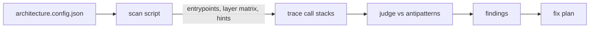

# Codebase architecture

Find where code sits in the wrong layer, show it as a pseudo call stack, and
plan fixes. The work has three parts:

1. **Scan.** A script lists entrypoints, puts files into layers, and reports
   candidate violations. The script is per codebase. See
   [references/scanner.md](references/scanner.md).
2. **Trace.** You read each selected entrypoint and write a high-level pseudo
   call stack. See [references/call-stack.md](references/call-stack.md).
3. **Judge and fix.** You check each frame against the antipatterns, write
   a work list of findings, and fix them when asked. See
   [references/antipatterns.md](references/antipatterns.md).



## Layer model

The default model has three main layers. A project config can rename, add, or
split layers, but keep these responsibilities.

| Layer | Owns | Must not |
| --- | --- | --- |
| route (handler, controller, view) | Validate untrusted input. Read request context. Call one service method. Map the result and errors to a response. Remove internal fields from output. | Run queries. Hold business rules. Call vendor SDKs. |
| service (use case, domain) | Business logic, workflows, domain policy, orchestration across repositories and adapters. | Know about HTTP. Build queries. Re-parse transport input. |
| database (repository, data access) | All persistence: queries, transactions, row scoping, row-to-record mapping. | Validate request input. Run workflows. Call non-persistence vendors. Import upper layers. |

Supporting layers: **middleware** (cross-cutting request concerns), **adapter**
(wrappers around vendor SDKs), **contracts** (shared schemas and types),
**composition** (wiring at startup, may import all layers).

Dependencies point down: `route → service → database`. `adapter` and
`contracts` are leaves that the upper layers may use.

## Workflow

### 0. Scope

Settle what to analyze before you start: all entrypoints, one domain (for
example `/api/invoices`), or one endpoint. Settle the output too: a work
list only, or the fixes too. Default: one domain, work list only.

### 1. Config

Look for `architecture.config.json` at the repository root, or use the path
the user gives.

- **Found:** use it. Read the project's agent instructions (for example
  `AGENTS.md`) too. Project rules override the defaults in this skill.
- **Missing:** bootstrap it. Follow "Bootstrap a codebase" in
  [references/scanner.md](references/scanner.md). Show the user the layer
  table and dependency matrix. Get their confirmation before you continue.

### 2. Scan

Run the scanner from the repository root:

```sh
bun <skill-dir>/scripts/scan.ts --config architecture.config.json [--entry /api/invoices] [--json]
```

Node: `node <skill-dir>/scripts/scan.ts` (23.6 or later), or add
`--experimental-strip-types` on 22.x. If the project has its own scanner (the
`scanner` field in the config, or a script that the project instructions
name), run that one instead. Every scanner must emit the contract in
[references/scanner.md](references/scanner.md).

Read the output in this order:

1. **Unlayered files.** If many files are unlayered, fix the config before
   you continue.
2. **Layer dependencies.** Any upward edge is a lead, for example
   `database -> service`. Layers with `mayImport` in the config report
   these edges as X3 hints.
3. **Entrypoints.** These are the stacks to trace.
4. **Candidate findings.** These are hints, not findings. Regex cannot tell
   decoding a stored row from validating a request.

### 3. Trace

For each selected entrypoint, read the route and follow calls down to the
database or vendor boundary. Write the stack in the notation from
[references/call-stack.md](references/call-stack.md).

- Trace a whole domain at a time. Endpoints in one route file share most
  frames.
- For more than about 15 endpoints, split them by route file across
  subagents, if you have them. Give each subagent the paths to
  `call-stack.md` and `antipatterns.md` and the config, and ask for stacks
  and findings in those formats.
- Keep stacks high level: one frame per layer crossing. Do not trace into
  SQL, framework internals, or same-layer helpers.

### 4. Judge

Check every frame against [references/antipatterns.md](references/antipatterns.md).

- Confirm or drop each scanner hint by reading the code at that line.
- Add the violations that only reading can find: every rule marked
  `Detect: read` or `scan+read` in the antipatterns file.
- When a hint is a correct, deliberate pattern, do not report it. Propose a
  config `exceptions` entry with a one-line reason.

### 5. Report and fix

The reader of your output is an agent that will fix the findings. Give it a
work list. There is no fixed template. Do not add summaries, tables, or
prose that the fixer does not need.

Each finding must carry:

- the location, as `file:line`;
- the rule ID;
- the concrete thing that is wrong: a call, branch, import, or field, not a
  category;
- the replacement: the target layer and the function or method that should
  own the code.

Group the findings by root cause, not by file. One service that takes the
HTTP context can cause findings in three routes; that is one fix. Add a
call stack or a stack diff only where it makes a fix clearer. Give clean
endpoints as a count.

Order the work so that each step compiles and passes tests: lower-layer
primitives first (repository method, adapter), then the service method,
then the thin route. Name the behavior that must stay the same: status
codes, error mapping, output shape. Flag changes that deployed clients or
other API consumers would see.

If the user asked only for analysis, stop after the work list. Otherwise
fix the findings in that order, one root cause at a time, and run the
project checks after each one.

## Boundaries

- Scope: layer placement and dependency direction. Correctness, security,
  and performance are out of scope. When a `sanitize` finding also leaks
  data, say so in one extra line.
- Do not report style or naming issues unless they hide a layer, for
  example a repository named `*Service`.
- Do not force the default model on a codebase that has a different one,
  such as hexagonal, CQRS, or framework conventions. Map its layers in the
  config and judge against that config.
