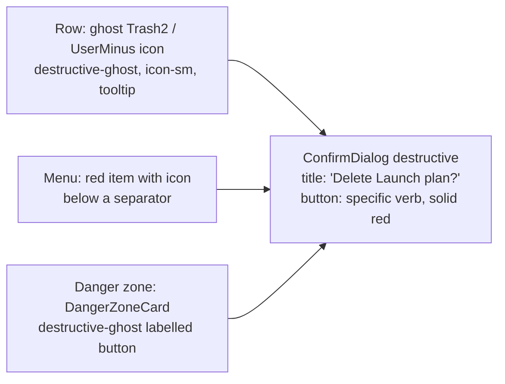

# Substrate design contract

This is the design contract for the renderer. If a rule and a screen disagree, change the screen.

Components and lint carry most of the contract. A shared component owns its own spacing, type, radius, motion, and states, so pick the component and its variant; do not restyle it. `design/*` and `shadcn/*` diagnostics name the component to use instead, and `tooling/design-lint/src/tokens.test.ts` keeps the colour tokens, server pages, emails, and app icon in step. This file keeps only what lint cannot check: which component fits which job, and the judgement calls around it.

Add a primitive or a variant only in `src/components/ui`, with the shadcn CLI for new primitives (hand-written only when shadcn has none, such as `Heading`, `Image`, and `Pressable`). Paths are relative to `apps/web/src`.

## 1. Visual hierarchy and destructive actions

### Type and radius

| Role                                                         | Use                                                                                  |
| ------------------------------------------------------------ | ------------------------------------------------------------------------------------ |
| Page title                                                   | `PageHeader variant="page"`, `AuthFrame`                                             |
| Record name in a sheet or aside body                         | `Heading variant="record"`                                                           |
| Settings section title                                       | `SettingsSection`                                                                    |
| Pane and sidebar title                                       | `PageHeader variant="pane"`, `PageSidebarHeader`                                     |
| Group or card title (settings card, home card, board column) | `GroupTitle` (`SettingsCard`, `SettingsList`), `CardTitle` in `Card size="sm"`       |
| Group label (sidebar section, record section, table head)    | `Heading variant="label"`, `RecordSection`, `PageSidebarGroupTitle`, `TableHead`     |
| Body / long-form text                                        | `text-sm` / `text-sm/relaxed` (record body, `MessageMarkdown`)                       |
| Description under a title                                    | `text-sm text-muted-foreground`; `text-xs` only under a group label                  |
| Meta and caption (times, counts, a row's second line)        | `text-xs text-muted-foreground`, `Timestamp`                                         |
| Emphasis in a row                                            | `font-medium`. Lint keeps `font-semibold` to unread items, message authors, initials |

- **Radius by nesting:** `rounded-xl` for a top-level container on a page (a bordered list, a stat tile beside cards). `rounded-lg` for a block inside a container, pane, sheet, or dialog (callout, dashed note, drop zone, message card) and for icon tiles of `size-8` and larger. `rounded-md` for rows, chips, and tiles of `size-7` and smaller. `rounded-full` only for people, count badges, and dots.
- **Inset surfaces** (quotes, callouts, card footers, a featured row) use `bg-inset`. A selected icon tile uses `bg-row-selected text-row-selected-foreground`.
- **One accent:** `primary` (ink cobalt) marks the primary action, focus, selection, today and now, unread, live agent work, and links. Surfaces, headings, and decorative icons stay neutral; hierarchy comes from size and colour.

### Destructive flow

- Every delete, remove, leave, or disconnect goes through `ConfirmDialog` with `destructive`. One exception: removing media the user can upload again (a profile or workspace picture) acts at once.

## 2. Validation copy

- Native constraint failures become field copy through `nativeValidationMessage` (`components/forms/use-native-validation.ts`). A required `NativeField` passes a specific `missingMessage` ("Enter a contact name."); the type requires it. A raw required input sets `data-missing-message`.
- Zod schemas give field-specific messages (`.min(1, "Enter a channel name.")`). Map multi-field drafts to per-field errors, as `routineErrors` does in `agent-work/routines/routine-draft.ts`.
- The error sits directly under its control in `FieldError`, and replaces the `FieldDescription`, so the two never stack. In a horizontal form, align controls on the input row (`items-start`). Long text uses `NativeField multiline` or `FormTextField multiline`.
- A labelled group of controls is `FieldSet` + `FieldLegend variant="label"`. A checkbox with a sentence label is `Field orientation="horizontal"` + `Checkbox` + `FieldContent` > `FieldLabel`.

## 3. Shared building blocks

### Items and card-like UI

- Use `Item` (`ui/item.tsx`) for a record row or compact card-like block: optional `ItemMedia`, `ItemContent`, trailing `ItemActions`. `ItemTitle` and `ItemDescription` are for short previews; rich text or instructions that must stay fully visible use plain content. Default size for richer blocks, `size="xs"` for compact lists, `variant="outline"` for a standalone bordered item.
- Preserve semantics: `<Item asChild><li>…</li></Item>` inside lists, or `<li><Item asChild><Link …>…</Link></Item></li>` for a linked row. Keep independent buttons outside links and buttons. `Item` does not provide selection state, disabled behaviour, or a control's accessible label.
- Put `RowActions` inside `ItemActions` and `group/row` on the owning item.
- Use `Card` for larger panels with their own header and body, `SettingsCard` for grouped settings, and the table, board, task-column, and message layouts for their specialized behaviour.

### Pages and settings

- **`PageHeader variant="page"`** heads collections, feeds, dashboards, settings, and record pages. Every workspace route renders in `PageLayout` → `PageContent`. Pick one of two widths: reading `max-w-4xl` (settings, feeds, record pages, agent panels, agenda) or full (tables, boards, dashboards). Action order: ghost `icon-sm` tools, then outline secondary, then one labelled primary "New X" `size="sm"`.
- **`PageHeader variant="pane"`** heads live tool surfaces and asides (conversation, calendar, agent page, thread, event, transcript). A subtitle link goes inside `title`. Every `PageSidebar` starts with `PageSidebarHeader`.
- **`SidebarNav`** is the link list of a `PageSidebar`: pass `items`, or `groups` with titles. A collapsible group title puts `Button variant="disclosure" size="xs"` in the `PageSidebarGroupTitle` band: label, count, then `ChevronRight`. Row icons take the row colour. A trailing count is quiet text; a filled pill is only for attention (mention `bg-primary`, needs you `toneFill.warning`). The in-pane agent section switcher is `PaneSectionNav`.
- **Toolbar** (no component): one `flex flex-wrap items-center gap-2` row under the page header. Left: search `Input type="search"` `w-72 max-w-full`, then filters (`SegmentedControl`, `Select`). Right (`ml-auto`): the Archived toggle, then the view toggle. Toolbar and results are one `gap-4` group. Full-bleed lists use the band form, `border-b px-6 py-2` (`TaskFilterLayout`). Line `Tabs` under a header sit in a `border-b` band with no toggles on the tab row.
- **Pagination** is one `Pager` under the results; `AppTable` renders its own. Page with `useCursorPages` for cursor APIs. Offer "Rows per page" only where the server supports page sizes.
- **Settings** use `SettingsShell` + `SettingsPanel` + `SettingsContent`, then `SettingsSection`, `SettingsCard` (`tone="destructive"` for a danger zone), `GroupTitle`, `SettingsRow`, `SettingsList`, `SettingsNote`, and `SettingsFooter`. Pass `inset` to `SettingsContent` inside a tab panel. A switch in a settings card is a `SettingsRow`; inside a dialog it is `Field orientation="horizontal"`. A danger zone is `DangerZoneCard`. Tab-wide actions go only in `SettingsSection actions`.
- **Save footer:** every settings card uses `<SettingsFooter dirty pending error onDiscard />`, and a card with unsaved edits also uses `UnsavedChangesGuard`. Workspace switches and sign-out call `confirmDiscardDrafts()` before they change anything. Pass `shouldBlock` to keep a draft across moves inside one record. A dialog that creates something has Cancel and a verb ("Create agent").
- **Guest pages** use `AuthFrame` with `AuthLink` and `AuthNavLink`; "Workspaces" always goes to `/organizations`. The main action is `size="lg" className="w-full"`; a second action is `variant="outline"` at the same size.

### Record sheets

- Use `PageSheet` (`layout/page-sheet.tsx`) for temporary contact, task, deal, and interaction details, and `PageAside` for persistent split panes, including threads. Contacts and interactions open over any workspace app through `ContactLink` and `InteractionLink`; the `/contacts?recordId=…` target stays the shareable route, and each detail checks its own access. Features own queries, access, URL selection, and unsaved-change guards. Sheets have no footer.
- **Header tools**, in order: the primary edit (`Pencil`), Copy link, open elsewhere (`ArrowUpRight`), one `Ellipsis` "More actions" menu, then Close. The header title names the kind or location; the record name is the body's `Heading variant="record"`.
- **Body order**: the name, the summary, properties, structural sections (subtasks, contacts, accounts, methods), work (follow-ups, attachments), context (interactions, meetings, discussions), and Activity last.
- **Sections** use `RecordSection`. Its one action is `RecordSectionAction` (`Plus` to create, add, or link); Attachments uses `AttachFilesButton iconOnly`; a choice is a `SegmentedControl` there.
- **Properties** use `PropertyList` + `Property`, with no card or border. Editable values are `Button variant="property"` or `SelectTrigger variant="ghost"`; unset values are `NotSet`.
- **Rows** in sections use `recordRows` and `Item size="xs"`, with no border or `divide-y`. Task and CRM activity is `TaskActivity`.

### People

- `PeoplePicker` adds people to a conversation, project, or group; `allowEmail` adds "Invite <email>". Do not ask for exact email addresses when the people are known. Organization invitations keep an email field.
- `PersonAvatar` shows a person or agent in rows, chips, and pickers; `Avatar` is for larger heads (message authors, person cards, the user menu, picture upload). A person is a circle with initials and an agent is a rounded square with the Bot mark. An organization uses `WorkspaceTile`, never an `Avatar`.
- `Tag` is the small label beside a name ("Agent", "External"). A status passes `tone` and an `icon`, so colour is never the only signal; a surface that carries a status reuses `toneBorder` and `toneFill`.
- `AccessRow` is one person or agent with access to a record or project.

### Dates

| Block            | Use                                                                                                                                                                                                                                                   | Implementation                             |
| ---------------- | ----------------------------------------------------------------------------------------------------------------------------------------------------------------------------------------------------------------------------------------------------- | ------------------------------------------ |
| Date helpers     | Lists and activity: `formatRelativeTime`. Messages: `formatTime`. Records and tables: `formatDateTime`. Short dates: `formatShortDate`. Day dividers: `formatDayLabel`. Tooltips: `formatFullTimestamp`. Date-only: `formatDueDate`, `parseDateOnly`. | `lib/format/date.ts`                       |
| `Timestamp`      | A `<time>` with the full timestamp in a tooltip. Inside an element that already has a tooltip, use the helpers with a native `title`.                                                                                                                 | `components/time/timestamp.tsx`            |
| `DueDate`        | "Today", "Tomorrow", or "Nov 4"; overdue is red and announced.                                                                                                                                                                                        | `components/time/due-date.tsx`             |
| `DateField`      | Every date-only form field. Date-and-time fields keep `datetime-local` until a time picker exists.                                                                                                                                                    | `components/forms/date-field.tsx`          |
| `DayDivider`     | The line with the day's name between messages from different days.                                                                                                                                                                                    | `messaging/messages/day-divider.tsx`       |
| `TimeZonePicker` | A searchable list of IANA time zones; never a free-text time zone.                                                                                                                                                                                    | `agent-work/routines/time-zone-picker.tsx` |

### States, tables, and tasks

- **`ContentNotice`** shows empty and unavailable states; `ErrorState` is its error tone. Name the situation with `icon` and offer at most one `action`, with no retry for a permanent 4xx. Pick the variant by place: the default for a page or pane with nothing else to show, `compact` in a card or a section with its own heading, `inline` in sheet sections, sidebar lists, and board columns. A failed load shows one error, in the region that would show the data.
- **`InlineNotice`** is a banner about the content's state, with the one action that changes it (reconnect, restore, join). `tone="warning"` is an alert; `neutral` is a status. It is not an empty state.
- **`AppTable`** is every table; it owns loading, errors, sorting, the frame, and the pager. Pass `columns` (`createAppColumnHelper<T>().columns([...])`), `data`, `getRowId`, a specific `empty`, and `pagination` (`mode: "server"` for API pages). Give short columns `meta.width`; dates use `dateTimeColumn`; amounts use `meta.align: "end"` with `NumberCell`. The first column links to the record (`tableLink`). Icon row actions go in `rowActions`, labelled buttons in a `meta.controls` column.
- **Boards** are `Board` > `BoardColumn` > `BoardCard` for the task board and the CRM pipeline. The whole card is the target (`boardCardTarget`); controls in a card sit above it with `relative z-10`. A board with more pages shows `Pager` under it.
- **Task status and priority** show only through `TaskStatusIcon` and `TaskPriorityIcon`, with colour on the icon only. Selects and menus use `taskStatusOptions` and `taskPriorityOptions`. Edit them in place with `TaskProperties`.
- **`InvitationStatus`** shows one human state per invitation; a pending invitation past its expiry reads "Expired".

## 4. Icons

One icon per concept, from `lucide-react`. Lint blocks the common synonyms (`Trash`, `MoreHorizontal`, `Edit`, `ExternalLink`, `AlertCircle`, `Loader2`, …).

| Concept                     | Icon                       | Concept                      | Icon                         |
| --------------------------- | -------------------------- | ---------------------------- | ---------------------------- |
| Create, add, new            | `Plus`                     | Delete a record              | `Trash2`                     |
| Remove a person or access   | `UserMinus`                | Remove a chip, token, filter | `X`                          |
| Add people                  | `UserPlus`                 | Close a pane or dialog       | `X`                          |
| Edit                        | `Pencil`                   | More actions                 | `Ellipsis`                   |
| Settings                    | `Settings`                 | Copy                         | `Copy` (→ `Check` when done) |
| Link / unlink               | `Link2` / `Unlink`         | Open elsewhere / external    | `ArrowUpRight`               |
| Back                        | `ArrowLeft`                | Search                       | `Search`                     |
| Retry, refresh              | `RefreshCw`                | Reset, resume                | `RotateCcw`                  |
| Error                       | `CircleAlert`              | Warning                      | `TriangleAlert`              |
| Needs you                   | `Hand`                     | Leave                        | `LogOut`                     |
| External collaboration      | `Globe`                    | Device (desktop)             | `Laptop`                     |
| Channel / private           | `Hash` / `LockKeyhole`     | DM / group                   | `MessageCircle` / `Users`    |
| Project                     | `FolderKanban`             | Task (kind)                  | `ListTodo`                   |
| Agent                       | `Bot`                      | Person                       | `UserRound`                  |
| Contact                     | `Contact`                  | Account                      | `Building2`                  |
| Deal                        | `Handshake`                | Interaction                  | `MessageSquare`              |
| Thread                      | `MessagesSquare`           | Message                      | `MessageSquareText`          |
| Theme light / dark / system | `Sun` / `Moon` / `Monitor` | New topic                    | `MessageSquarePlus`          |
| Move task (to a project)    | `FolderInput`              | Move deal (to a stage)       | `ArrowRightLeft`             |
| Open a picker or select     | `ChevronDown`              | Go to an in-app page         | `ArrowRight` (trailing)      |

Record kinds take their icon and singular label from `entityKinds` in `components/context/entity-kinds.ts`.

### Action placement

- **Icon-only buttons** have an `aria-label` (lint checks it) and a `Tooltip` with the same words: `TooltipTrigger asChild` around the button, or `DropdownMenuTrigger asChild` inside `TooltipTrigger asChild` for a menu. The tooltip may add a `Kbd` group, and the `aria-label` may append the object ("Unlink Launch plan").
- **Create** in pane and sidebar headers is a ghost `icon-sm` `Plus` (`icon-xs` in board column headers). In page headers, empty states, and form footers it is one labelled primary button ("New deal").
- **Row actions** (edit, delete, remove, resend) are icon buttons in `RowActions`, with `group/row` on the row. Delete is `RowAction destructive`. Labelled buttons ("Approve", "Disconnect") are not row actions and stay visible.
- **Pane tools** (edit, copy link, close, more) are ghost `icon-sm` buttons in a plain `role="group"` `flex gap-0.5`, not joined outline buttons.
- **Conversation names** put `conversationKindIcon` beside the bare name; running text uses `conversationLabel`.

## 5. Spacing

Shared components own their insets. For layout you compose yourself, use these steps; lint rejects arbitrary values.

| Place                       | Value                                                                 |
| --------------------------- | --------------------------------------------------------------------- |
| Page sections               | `space-y-6`; page header → toolbar `gap-6`; toolbar → results `gap-4` |
| Toolbar and tool groups     | `gap-2` between controls, `gap-0.5` between ghost icon tools          |
| Rows                        | `gap-2` between icon and text; `PersonAvatar` default or `size="xs"`  |
| Fields and groups in a card | `gap-4` between fields, `gap-6` between groups                        |
| Sheet and aside sections    | `gap-6` between sections, `gap-2` inside a section                    |

Do not reserve empty space for content that may not appear (hidden action rows, `min-h` error slots).

## 6. Motion

- The primitives own all motion: `Button` press, menus and popovers, `Dialog`, `Tooltip`, `Collapsible`, `PageSheet`, and `PageAside`. Feature code adds no animation of its own; lint rejects `transition-all`, looping attention effects, and hover growth.
- `ease-out` and `ease-drawer` in `components/styles.css` are the only curves, and `prefers-reduced-motion` shortens every animation there.
- Live agent work is the `working` tone of `Tag` or `WorkIndicator`; "needs you" is a steady dot.
- Keyboard-opened palettes and high-frequency list reflow do not animate.

## 7. Copy

- Sentence case everywhere: "Not started", "No priority", "Project access". Labels come from maps such as `tasks/task-cues/task-labels.ts`.
- Create actions: the trigger and dialog title say "New <thing>", and the submit says "Create <thing>". An edit dialog submits with "Save". A domain verb is only for actions that do not create: "Link account", "Move deal", "Share deal", "Start conversation".
