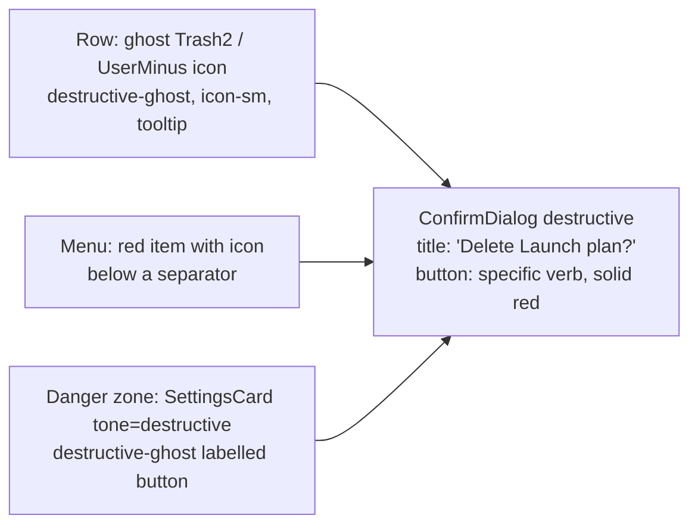

# Startup OS design contract

This is the design contract for the renderer. Each rule names the component that implements it. If a rule and a screen disagree, change the screen. Add a primitive or a variant only in `src/components/ui`, with the shadcn CLI for new primitives.

Design lint (`design/*` and `shadcn/*` rules) points to the sections below. Fix design lint errors and warnings in the files you touch. See [§ 8](#8-lint).

Paths are relative to `apps/web/src`.

## 1. Primitives

| Rule                                                                                                                                                                                                                                                                                                                                                                                                                                 | Implementation                                                                                                        |
| ------------------------------------------------------------------------------------------------------------------------------------------------------------------------------------------------------------------------------------------------------------------------------------------------------------------------------------------------------------------------------------------------------------------------------------ | --------------------------------------------------------------------------------------------------------------------- |
| Checkboxes are square (`rounded-sm`). Circles mean radio: one choice in a list of options is a `RadioGroup`.                                                                                                                                                                                                                                                                                                                         | `components/ui/checkbox.tsx`, `components/ui/radio-group.tsx`                                                         |
| `destructive` is **solid red** with white text. Use it only for the confirm button of a destructive `ConfirmDialog`.                                                                                                                                                                                                                                                                                                                 | `components/ui/button.tsx`, token `--destructive-solid` in `components/styles.css`                                    |
| `destructive-ghost` is the quiet red: text triggers ("Delete agent", "Disconnect", "Stop") are red at rest; icon-only triggers are muted and turn red on hover or focus.                                                                                                                                                                                                                                                             | `components/ui/button.tsx`                                                                                            |
| Menu items that destroy use `DropdownMenuItem variant="destructive"`, have an icon, and sit last, below a `DropdownMenuSeparator`.                                                                                                                                                                                                                                                                                                   | `components/ui/dropdown-menu.tsx`, example `messaging/conversations/actions/conversation-actions-menu.tsx`            |
| **Dialogs** are a column: `DialogHeader` (with `DialogTitle`) and `DialogFooter` stay fixed, and `DialogBody` is the only part that scrolls. A `<form>` that is a direct child of `DialogContent` is `display: contents`, so put `DialogBody` and `DialogFooter` inside the form.                                                                                                                                                    | `components/ui/dialog.tsx`                                                                                            |
| Dialog widths: `size="default"` (`max-w-lg`) for confirms and short forms, `size="lg"` (`max-w-2xl`) for editors and long forms. Do not pass `max-w-*` classes.                                                                                                                                                                                                                                                                      | `DialogContent size`                                                                                                  |
| **Footer order**: Cancel (outline) then primary, right-aligned. Every modal form has an explicit Cancel. The close X sits at `top-4 right-4`, on the title line.                                                                                                                                                                                                                                                                     | `DialogFooter`, `feedback/confirm-dialog.tsx`                                                                         |
| Menus size to content: `w-max`, `min-w-44`, `max-w-80`; items never wrap. Every item in a menu has an icon, or none does.                                                                                                                                                                                                                                                                                                            | `components/ui/dropdown-menu.tsx`                                                                                     |
| One choice among 2–4 short options (theme, fit/fill, Tasks/Projects, schedule kind) is a `SegmentedControl`; with `iconOnly`, each option keeps its label as tooltip and name. Outline buttons never carry `aria-pressed`. Line `Tabs` are only for page sections.                                                                                                                                                                   | `components/forms/segmented-control.tsx` on `components/ui/toggle-group.tsx` (variant `segmented` in `ui/toggle.tsx`) |
| Theme is chosen with one control, labelled "Theme", everywhere (guest pages, user menu, settings).                                                                                                                                                                                                                                                                                                                                   | `components/theme/theme-control.tsx` (`ThemeControl`)                                                                 |
| List rows: hover is `bg-row-hover`; selected is `bg-row-selected` + `font-medium` + `text-row-selected-foreground`. The two are distinct in both themes. Do not use `bg-muted/40`, `bg-muted/50`, or `bg-sidebar-accent` for row states.                                                                                                                                                                                             | tokens in `components/styles.css`; `Button variant="sidebar"`, `ui/table.tsx` rows                                    |
| Buttons get their height from `size` (`default`, `xs`, `sm`, `lg`, `icon`, `icon-xs`, `icon-sm`, `icon-lg`, `selection`), not from `h-*` classes. Width (`w-full`) and margin are fine. Variants: `default`, `outline`, `secondary`, `ghost`, `destructive`, `destructive-ghost`, `link`, `sidebar` (list rows), `disclosure` (expand headers), `property` (a value that opens a picker), `reaction`, `rail`, `workspace`, `avatar`. | `components/ui/button.tsx`                                                                                            |
| A property that reads as text until hovered (a task's status, assignee, due date in its inspector) is `Button variant="property"` or `SelectTrigger variant="ghost"`, not a bordered field.                                                                                                                                                                                                                                          | `components/ui/button.tsx`, `components/ui/select.tsx`, example `tasks/detail/task-properties.tsx`                    |
| Fields share one height (`Input`, `SelectTrigger size="default"`). Use `SelectTrigger size="sm"` for compact selects; do not set `h-*` on fields.                                                                                                                                                                                                                                                                                    | `components/ui/input.tsx`, `components/ui/select.tsx`                                                                 |

### Destructive flow

- Confirm labels name the object: "Delete conversation", "Delete agent", "Delete skill", "Remove access", "Reset defaults". Never a bare "Delete" or "OK".
- Every delete, remove, leave, or disconnect goes through `ConfirmDialog` with `destructive`. Never use `window.confirm`, `alert`, or `prompt`.
- Errors use reviewed copy through `FormMessage` (`errorDescription` gives the fallback) or `actionErrorMessage(error, fallback)` from `components/feedback/action-error-message.ts`. Raw server or library text (`error.message`) is never shown, including in toasts.

## 2. Validation copy

| Rule                                                                                                                                                                                                                                                                                          | Implementation                                                                 |
| --------------------------------------------------------------------------------------------------------------------------------------------------------------------------------------------------------------------------------------------------------------------------------------------- | ------------------------------------------------------------------------------ |
| Never show browser text ("Please fill out this field.") or library text ("Too small: expected string…"). Do not render `validationMessage` or a zod `issue.message`.                                                                                                                          | `lib/forms/validation-messages.ts`                                             |
| Native constraint failures map to field copy: empty → "Enter <label>." (email: "Enter your email address.", password: "Enter your password."), bad email → "Enter a complete email address, like name@company.com.", too short → "Use at least N characters.", pattern → the input's `title`. | `nativeValidationMessage`, used by `components/forms/use-native-validation.ts` |
| When "Enter <label>." reads badly, pass `missingMessage` to `NativeField` (or `data-missing-message` on a raw input).                                                                                                                                                                         | `components/forms/native-form.tsx`                                             |
| Zod schemas give field-specific messages (`.min(1, "Enter a channel name.")`). A renderer-wide `z.config({ customError })` turns any remaining issue into plain copy. Map multi-field drafts to per-field errors, as `routineErrors` does.                                                    | `main.tsx`, `schemaIssueMessage`, `agent-work/routines/routine-draft.ts`       |
| Error layout: the error sits directly under its control in `FieldError` (`role="alert"`), and the control gets `aria-invalid` + `aria-describedby`. In a horizontal form, align controls on the input row (`items-start`), not on the error (`items-end`).                                    | `components/ui/field.tsx`, `components/forms/*`                                |

## 3. Shared building blocks

### Pages and settings

| Block                            | Use                                                                                                                                                                                                                                                                                                                                                                                                                                          | Implementation                                                                                                                |
| -------------------------------- | -------------------------------------------------------------------------------------------------------------------------------------------------------------------------------------------------------------------------------------------------------------------------------------------------------------------------------------------------------------------------------------------------------------------------------------------- | ----------------------------------------------------------------------------------------------------------------------------- |
| `PageHeader variant="page"`      | Full pages (Notifications, a project, Needs you): `text-xl` semibold title, muted description, actions right. Inside the page's `p-6` inset. Do not hand-build `<h1>` page titles.                                                                                                                                                                                                                                                           | `components/layout/page-header.tsx`                                                                                           |
| `PageHeader variant="pane"`      | Panes: one 48px (`h-12`) line, `px-4`, bottom border, `text-sm` semibold title with an optional kind icon, ghost `icon-sm` tools with `gap-0.5`. `PageSidebarHeader` is this variant without the border.                                                                                                                                                                                                                                     | `components/layout/page-header.tsx`, `layout/page-layout/page-sidebar.tsx`, `messaging/conversations/conversation-header.tsx` |
| `SettingsPage` + `SettingsPanel` | A settings area: `SettingsPage` is the frame (section sidebar, `p-6`); `SettingsPanel` is the open section (PageHeader, `max-w-3xl`, `space-y-6`). No uppercase eyebrow.                                                                                                                                                                                                                                                                     | `components/layout/settings-page.tsx`, `settings/settings-shell.tsx`                                                          |
| Settings groups                  | `SettingsSection` (one tab: title, description, actions, then groups), `SettingsCard` (a bordered group with `footer`; `tone="destructive"` for a danger zone), `GroupTitle`, `SettingsRow` (label and description left, control right), `SettingsList`, `SettingsNote`, `SettingsFooter` (status left, Cancel/Discard then Save right). Use them for user, organization, project, and agent settings instead of hand-built cards and `h2`s. | `components/layout/settings-section.tsx`                                                                                      |
| Guest pages                      | Signed-out and pre-workspace pages use `AuthFrame` (one background, `BrandMark`, top-anchored card). Inline links are `AuthLink`; secondary navigation in the frame's actions is `AuthNavLink`.                                                                                                                                                                                                                                              | `components/auth/auth-frame.tsx`, `auth/brand-mark.tsx`, `auth/auth-link.tsx`                                                 |

### People

| Block          | Use                                                                                                                                                                                                                                                                                                                  | Implementation                                                                |
| -------------- | -------------------------------------------------------------------------------------------------------------------------------------------------------------------------------------------------------------------------------------------------------------------------------------------------------------------- | ----------------------------------------------------------------------------- |
| `PeoplePicker` | Adding people to a conversation, project, or group: a token input that suggests members and agents by name or email; `allowEmail` adds "Invite <email>". Do not ask for exact email addresses when the people are known. Organization invitations, which invite people who are not members yet, keep an email field. | `components/people/people-picker.tsx`, logic in `lib/people/people-picker.ts` |
| `PersonAvatar` | A person or agent in rows, chips, and pickers: 24px, or 20px with `size="xs"`; `agent` shows the Bot mark.                                                                                                                                                                                                           | `components/people/person-avatar.tsx`                                         |
| `Avatar`       | Larger heads only: message authors (`variant="message"`), person cards, comments, the user menu, picture upload.                                                                                                                                                                                                     | `components/ui/avatar.tsx`                                                    |
| `Tag`          | A small bordered label beside a name, such as "Agent" or "External".                                                                                                                                                                                                                                                 | `components/feedback/tag.tsx`                                                 |

### Dates

| Block            | Use                                                                                                                                                                                                                                                                                                                                                                                                                                                                                                                                                           | Implementation                             |
| ---------------- | ------------------------------------------------------------------------------------------------------------------------------------------------------------------------------------------------------------------------------------------------------------------------------------------------------------------------------------------------------------------------------------------------------------------------------------------------------------------------------------------------------------------------------------------------------------- | ------------------------------------------ |
| Date helpers     | All display text comes from one module. Lists and activity: `formatRelativeTime` ("now", "5m", "3h", "6d", then "Nov 8"; year only outside the current year). Messages: `formatTime` ("3:40 PM"). Records and tables: `formatDateTime` ("Nov 8, 3:40 PM"). Short dates: `formatShortDate`. Day dividers: `formatDayLabel` ("Today", "Yesterday", "Monday, November 2"). Tooltips: `formatFullTimestamp`. Date-only values: `formatDueDate`, `parseDateOnly`. Do not call `toLocale*String` or `Intl.DateTimeFormat` in views, and never show `toISOString()`. | `lib/format/date.ts`                       |
| `Timestamp`      | A `<time>` with `format="relative"`, `"time"`, `"date"`, or `"datetime"`, and the full timestamp in a tooltip. Inside an element that already has a tooltip, use the format helpers with a native `title` instead.                                                                                                                                                                                                                                                                                                                                            | `components/time/timestamp.tsx`            |
| `DueDate`        | "Today", "Tomorrow", or "Nov 4"; overdue is red, medium weight, and says "overdue" to screen readers; the tooltip has the full date. Date-only values are parsed in local time.                                                                                                                                                                                                                                                                                                                                                                               | `components/time/due-date.tsx`             |
| `DayDivider`     | The line with the day's name between messages from different days.                                                                                                                                                                                                                                                                                                                                                                                                                                                                                            | `messaging/messages/day-divider.tsx`       |
| `TimeZonePicker` | A searchable list of IANA time zones; never a free-text time zone.                                                                                                                                                                                                                                                                                                                                                                                                                                                                                            | `agent-work/routines/time-zone-picker.tsx` |

### States, tables, and tasks

| Block                  | Use                                                                                                                                                                                                                                                                                           | Implementation                                                                                                                                       |
| ---------------------- | --------------------------------------------------------------------------------------------------------------------------------------------------------------------------------------------------------------------------------------------------------------------------------------------- | ---------------------------------------------------------------------------------------------------------------------------------------------------- |
| `ContentNotice`        | Empty or unavailable states. Takes `icon` (name the situation: `Unlink` broken link, `MailX` missing invitation, `Users` no members, `Send`/`Mail` invitations) and an optional single `action`. Titles have no trailing period. No retry for permanent 4xx.                                  | `components/feedback/content-notice.tsx`                                                                                                             |
| `AppTable` empty state | With no rows, show only the notice (no header row). Pass `emptyMessage`, a specific `emptyDescription`, and `emptyIcon`.                                                                                                                                                                      | `components/table/app-table.tsx`                                                                                                                     |
| Status and priority    | Show task status only with `TaskStatusIcon` (+ its label) and priority with `TaskPriorityIcon`. Color is on the icon only. Selects and menus use `taskStatusOptions` and `taskPriorityOptions`, which carry the icons. Do not draw status dots or reuse `CircleCheck` as a generic task icon. | `components/tasks/task-cues/*`                                                                                                                       |
| Task properties        | Edit status, priority, assignee, and due date in place: `TaskStatusMenu`, `AssigneePicker`, `TaskDueDatePicker`, assembled by `TaskProperties`.                                                                                                                                               | `tasks/list/task-status-menu.tsx`, `tasks/assignee/assignee-picker.tsx`, `tasks/detail/task-due-date-picker.tsx`, `tasks/detail/task-properties.tsx` |
| `InvitationStatus`     | One human state per invitation; a pending invitation past its expiry reads "Expired".                                                                                                                                                                                                         | `organizations/invitations/invitation-status.tsx`                                                                                                    |

## 4. Icons

One icon per concept, from `lucide-react`. Import the plain name (`Pencil`, not `PencilIcon` or `LucidePencil`) outside `components/ui`. `ImageIcon` is the exception, because `Image` is a browser global.

| Concept                     | Icon                       | Concept                      | Icon                         |
| --------------------------- | -------------------------- | ---------------------------- | ---------------------------- |
| Create, add, new            | `Plus`                     | Delete a record              | `Trash2`                     |
| Remove a person or access   | `UserMinus`                | Remove a chip, token, filter | `X`                          |
| Add people                  | `UserPlus`                 | Close a pane or dialog       | `X`                          |
| Edit                        | `Pencil`                   | More actions                 | `Ellipsis`                   |
| Settings                    | `Settings`                 | Copy                         | `Copy` (→ `Check` when done) |
| Link / unlink               | `Link2` / `Unlink`         | Open elsewhere / external    | `ArrowUpRight`               |
| Back                        | `ArrowLeft`                | Search                       | `Search`                     |
| Retry, refresh              | `RefreshCw`                | Reset, resume                | `RotateCcw`                  |
| Error                       | `CircleAlert`              | Warning                      | `TriangleAlert`              |
| Needs you                   | `Hand`                     | Leave                        | `LogOut`                     |
| External collaboration      | `Globe`                    | Device (desktop)             | `Laptop`                     |
| Channel / private           | `Hash` / `LockKeyhole`     | DM / group                   | `MessageCircle` / `Users`    |
| Project                     | `FolderKanban`             | Task (kind)                  | `ListTodo`                   |
| Agent                       | `Bot`                      | Person                       | `UserRound`                  |
| Theme light / dark / system | `Sun` / `Moon` / `Monitor` | New topic                    | `MessageSquarePlus`          |

Rotating an image (`RotateCw`, `RotateCcw` in the cropper) is its own concept.

### Action placement

- **Icon-only buttons** have an `aria-label` and a `Tooltip` with the same words (`TooltipTrigger asChild` around the button; for a menu or popover trigger, `DropdownMenuTrigger asChild` inside `TooltipTrigger asChild`).
- **Create** in pane and sidebar headers: ghost `icon-sm` `Plus` with a tooltip that matches its `aria-label`. In empty states and form footers: one labelled primary button.
- **Delete** in rows: `destructive-ghost` `icon-sm` `Trash2` (`UserMinus` for people) with a tooltip, revealed on row hover and focus where the row has other content.
- **Pane tools** (edit, copy link, close, more): ghost `icon-sm` in a plain `role="group"` `flex gap-0.5`, not a `ButtonGroup` of outline buttons. `ButtonGroup` is for joined controls, such as a select with a stepper.

## 5. Spacing

The scale is Tailwind's 4px steps. Prefer the values below; anything else needs a reason.

| Place                     | Value                                                                                |
| ------------------------- | ------------------------------------------------------------------------------------ |
| Full-page inset           | `p-6` (24px)                                                                         |
| Pane header               | `h-12`, `px-4`, tools `gap-0.5`                                                      |
| Sidebar content           | `px-2 py-3`, sections `space-y-5`, rows `gap-0.5`                                    |
| List rows                 | 32–36px: `h-8` nav rows, `py-1.5`/`py-2` content rows; `gap-2` between icon and text |
| Dialog                    | header `px-5 pt-5 pb-4`, body `px-5 pb-5 gap-4`, footer `px-5 py-3`                  |
| Cards and settings groups | `p-5` inside, `gap-4` between fields, `gap-6` between groups                         |
| Page sections             | `space-y-6`                                                                          |

Do not reserve empty space for content that may not appear (hidden action rows, `min-h` error slots).

## 6. Motion

| Rule                                                                                                                                                                      | Implementation                                                                 |
| ------------------------------------------------------------------------------------------------------------------------------------------------------------------------- | ------------------------------------------------------------------------------ |
| `ease-out` is the strong curve `cubic-bezier(0.23, 1, 0.32, 1)`; `ease-drawer` is for drawers. Never `ease-in` on UI.                                                     | `@theme` in `components/styles.css`                                            |
| Buttons scale to `0.97` on press (`transition`, 150ms). List rows (`sidebar`), `property` buttons, and disclosure headers do not scale. Reduced motion removes the scale. | `components/ui/button.tsx`                                                     |
| Popover, dropdown, select, hover card: fade + scale from `0.97` at the trigger origin, 150ms in, 100ms out, no slide.                                                     | `ui/popover.tsx`, `ui/dropdown-menu.tsx`, `ui/select.tsx`, `ui/hover-card.tsx` |
| Dialogs: fade + scale from `0.97`, centered, 200ms in, 150ms out.                                                                                                         | `ui/dialog.tsx`                                                                |
| Tooltips: only the first, delayed open animates (125ms fade + scale); moving to the next trigger opens instantly.                                                         | `ui/tooltip.tsx`                                                               |
| No infinite `animate-ping` or `animate-bounce`. Working is a soft `motion-safe:animate-pulse` dot; "needs you" is a steady dot.                                           | `agent-work/work-indicator.tsx`                                                |
| `prefers-reduced-motion` shortens every animation and transition to near zero.                                                                                            | `components/styles.css`                                                        |
| Animate `transform` and `opacity` only. Keyboard-opened palettes and high-frequency list reflow do not animate.                                                           | review rule                                                                    |

## 7. Copy

- Sentence case everywhere: "Not started", "No priority", "Project access". Do not use `uppercase` or `capitalize` to change the case of labels and headings; write the text in the case it should read (labels come from maps such as `tasks/task-cues/task-labels.ts`).
- Small group labels use `text-xs font-medium text-muted-foreground`, not an uppercase eyebrow.
- Titles of notices and empty states have no trailing period.
- Name the object in actions and confirmations ("Delete conversation", "Remove Bob").

## 8. Lint

`bun run lint` checks this contract. Errors have one correct answer; warnings are heuristics. If a warning is wrong for a case, say why in an `oxlint-disable-next-line` comment.

| Rule                                                                                                                           | Severity | Section                                             |
| ------------------------------------------------------------------------------------------------------------------------------ | -------- | --------------------------------------------------- |
| `design/canonical-icons` (autofix)                                                                                             | error    | § 4                                                 |
| `design/no-adhoc-date-format`                                                                                                  | error    | § 3 Dates                                           |
| `design/no-raw-validation-text`                                                                                                | error    | § 2                                                 |
| `design/no-raw-error-message`                                                                                                  | warn     | § 1 Destructive flow                                |
| `design/no-solid-destructive` (suggestion)                                                                                     | error    | § 1 Destructive flow                                |
| `design/no-native-dialogs`                                                                                                     | error    | § 1 Destructive flow                                |
| `design/icon-button-name`                                                                                                      | error    | § 4 Action placement                                |
| `design/icon-button-tooltip`                                                                                                   | warn     | § 4 Action placement                                |
| `design/dialog-structure`                                                                                                      | warn     | § 1 Dialogs                                         |
| `design/dialog-footer-order`                                                                                                   | error    | § 1 Footer order                                    |
| `design/motion`                                                                                                                | error    | § 6                                                 |
| `design/sentence-case`                                                                                                         | warn     | § 7                                                 |
| `design/page-header`                                                                                                           | warn     | § 3 Pages and settings                              |
| `design/no-pressed-outline`                                                                                                    | error    | § 1                                                 |
| `shadcn/no-restyle` contracts (Button, Dialog parts, Card parts, Checkbox, DropdownMenu, Input, SelectTrigger, TableRow, Tabs) | error    | § 1, § 5                                            |
| `shadcn/no-raw-colors`, `no-arbitrary-values`, `no-unknown-classes`, `require-static-classes`                                  | error    | theme tokens in `components/styles.css`             |
| `shadcn/no-inline-styles`                                                                                                      | warn     | run-time values only, through CSS custom properties |
