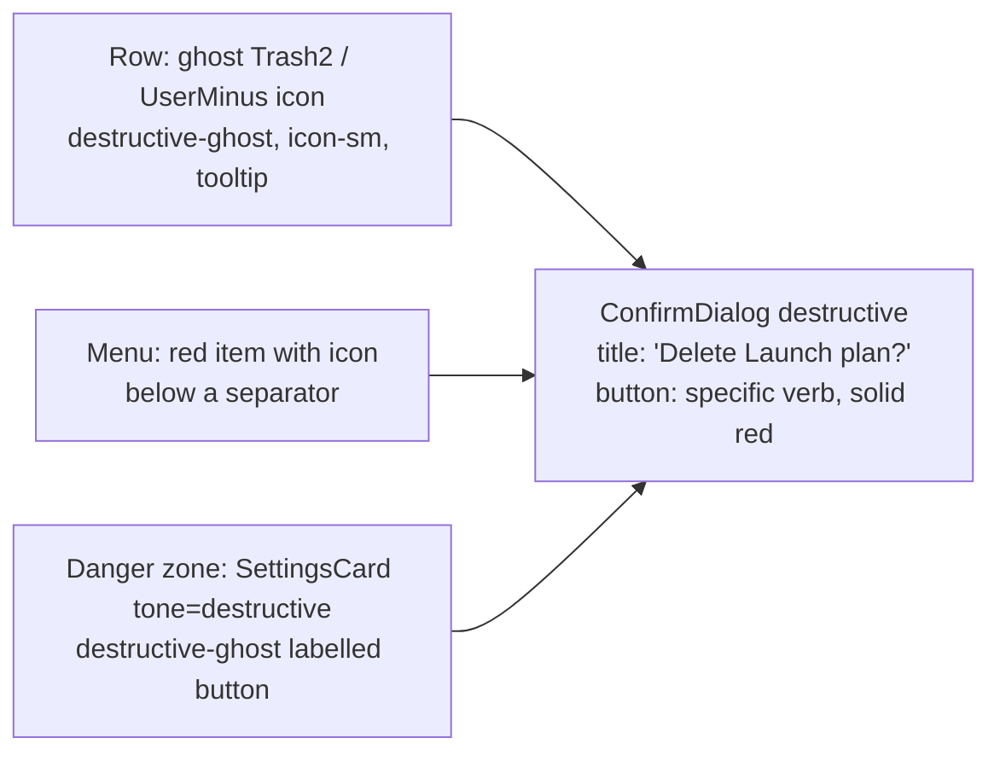

# Substrate design contract

This is the design contract for the renderer. Each rule names the component that implements it. If a rule and a screen disagree, change the screen. Add a primitive or a variant only in `src/components/ui`, with the shadcn CLI for new primitives.

Design lint (`design/*` and `shadcn/*` rules) points to the sections below. Fix design lint errors and warnings in the files you touch. See [§ 8](#8-lint).

Paths are relative to `apps/web/src`.

## 1. Primitives

| Rule                                                                                                                                                                                                                                                                                                                                                                                                                                                                                                                                                                                                                                                                                                                                                                   | Implementation                                                                                                                                  |
| ---------------------------------------------------------------------------------------------------------------------------------------------------------------------------------------------------------------------------------------------------------------------------------------------------------------------------------------------------------------------------------------------------------------------------------------------------------------------------------------------------------------------------------------------------------------------------------------------------------------------------------------------------------------------------------------------------------------------------------------------------------------------- | ----------------------------------------------------------------------------------------------------------------------------------------------- |
| Checkboxes are square (`rounded-sm`). Circles mean radio: one choice in a list of options is a `RadioGroup`.                                                                                                                                                                                                                                                                                                                                                                                                                                                                                                                                                                                                                                                           | `components/ui/checkbox.tsx`, `components/ui/radio-group.tsx`                                                                                   |
| `destructive` is **solid red** with white text. Use it only for the confirm button of a destructive `ConfirmDialog`.                                                                                                                                                                                                                                                                                                                                                                                                                                                                                                                                                                                                                                                   | `components/ui/button.tsx`, token `--destructive-solid` in `components/styles.css`                                                              |
| `destructive-ghost` is the quiet red: text triggers ("Delete agent", "Disconnect", "Stop") are red at rest; icon-only triggers are muted and turn red on hover or focus.                                                                                                                                                                                                                                                                                                                                                                                                                                                                                                                                                                                               | `components/ui/button.tsx`                                                                                                                      |
| Menu items that destroy use `DropdownMenuItem variant="destructive"`, have an icon, and sit last, below a `DropdownMenuSeparator`.                                                                                                                                                                                                                                                                                                                                                                                                                                                                                                                                                                                                                                     | `components/ui/dropdown-menu.tsx`, example `messaging/conversations/actions/conversation-actions-menu.tsx`                                      |
| **Dialogs** are a column: `DialogHeader` (with `DialogTitle`) and `DialogFooter` stay fixed, and `DialogBody` is the only part that scrolls. A `<form>` that is a direct child of `DialogContent` is `display: contents`, so put `DialogBody` and `DialogFooter` inside the form. A dialog hangs from a fixed top edge (`top-dialog-top`, about 12% of the window), never vertically centered, so validation or suggestions that add a line extend it downward and the title does not move. Focus returns to the element that had it when the dialog opened, also for a dialog mounted by state (a confirm); a dialog opened from something that disappears (a menu item) passes `onCloseAutoFocus` (or `ConfirmDialog onRestoreFocus`) and focuses a stable launcher. | `components/ui/dialog.tsx`                                                                                                                      |
| Dialog widths: `size="default"` (`max-w-lg`) for confirms and short forms, `size="lg"` (`max-w-2xl`) for editors and long forms. Do not pass `max-w-*` classes. `FormDialog` defaults to `default`; editors (task, routine, skill, MCP server, agent, deal) pass `lg`.                                                                                                                                                                                                                                                                                                                                                                                                                                                                                                 | `DialogContent size`                                                                                                                            |
| **Footer order**: Cancel (outline) then primary, right-aligned. Every modal form has an explicit Cancel. The close X sits at `top-4 right-4`, on the title line. A modal form is `FormDialog` (pass `nativeValidation` for `NativeField` children); hand-build a dialog only for non-form content (viewer, picker, cropper), and give it `modalDialogProps` for open, close, pending, and focus.                                                                                                                                                                                                                                                                                                                                                                       | `DialogFooter`, `feedback/confirm-dialog.tsx`                                                                                                   |
| Menus size to content: `w-max`, `min-w-44`, `max-w-80`; items never wrap. Every item in a menu has an icon, or none does.                                                                                                                                                                                                                                                                                                                                                                                                                                                                                                                                                                                                                                              | `components/ui/dropdown-menu.tsx`                                                                                                               |
| One choice among 2–4 short options (theme, fit/fill, Tasks/Projects, schedule kind) is a `SegmentedControl`; with `iconOnly`, each option keeps its label as its accessible name, without a tooltip. Outline buttons never carry `aria-pressed`. Line `Tabs` are only for page sections; a popover or palette with more types (search, references) uses the default pill `Tabs`, which look like a `SegmentedControl`. A tooltip never wraps a toggle item directly, because it overwrites the item's `data-state` and hides the chosen option.                                                                                                                                                                                                                        | `components/forms/segmented-control.tsx` on `components/ui/toggle-group.tsx` (variant `segmented` in `ui/toggle.tsx`), `components/ui/tabs.tsx` |
| Theme is chosen with one control, labelled "Theme", everywhere (guest pages, user menu, settings).                                                                                                                                                                                                                                                                                                                                                                                                                                                                                                                                                                                                                                                                     | `components/theme/theme-control.tsx` (`ThemeControl`)                                                                                           |
| List rows: hover is `bg-row-hover`; selected is `bg-row-selected` + `font-medium` + `text-row-selected-foreground`. The two are distinct in both themes. In a palette or picker (`CommandItem`), the keyboard cursor is a third, neutral state, `bg-row-highlight`, so it never reads as a chosen row; a chosen row shows a checkbox or check. Do not use `bg-muted/40`, `bg-muted/50`, `bg-accent`, or `bg-sidebar-accent` for row states.                                                                                                                                                                                                                                                                                                                            | tokens in `components/styles.css`; `Button variant="sidebar"`, `ui/table.tsx` rows                                                              |
| Buttons get their height from `size` (`default`, `xs`, `sm`, `lg`, `icon`, `icon-xs`, `icon-sm`, `icon-lg`, `selection`), not from `h-*` classes. Width (`w-full`) and margin are fine. Variants: `default`, `outline`, `secondary`, `ghost`, `destructive`, `destructive-ghost`, `link`, `sidebar` (list rows), `disclosure` (expand headers), `property` (a value that opens a picker), `reaction`, `rail`, `workspace`, `avatar`.                                                                                                                                                                                                                                                                                                                                   | `components/ui/button.tsx`                                                                                                                      |
| A property that reads as text until hovered (a task's status, assignee, due date in its inspector) is `Button variant="property"` or `SelectTrigger variant="ghost"`, not a bordered field. A popover or combobox trigger that sits in a form beside inputs (task Assignee and Due date, a routine's Time zone) is `Button variant="field"`: the `Input` boundary and height, full width, value in regular weight.                                                                                                                                                                                                                                                                                                                                                     | `components/ui/button.tsx`, `components/ui/select.tsx`, example `tasks/detail/task-properties.tsx`, `tasks/editor/task-schedule-fields.tsx`     |
| Fields share one height (`Input`, `SelectTrigger size="default"`). Use `SelectTrigger size="sm"` for compact selects; do not set `h-*` on fields.                                                                                                                                                                                                                                                                                                                                                                                                                                                                                                                                                                                                                      | `components/ui/input.tsx`, `components/ui/select.tsx`                                                                                           |
| Two border strengths: fields use `border-input`, a clear 3:1 boundary (dimmer in dark mode so it does not glow). Outline buttons use the quieter `border-control-border`. Surfaces use `border`. In dark mode every font weight steps down about 60 (`--font-weight-*` in `.dark`: 340, 430, 520, 620) and the text colour sits below white, because light text on a dark ground looks heavier and Windows ignores font smoothing. Floating surfaces share three shadows: `shadow-surface`, `shadow-raised`, `shadow-floating` (menus, popovers, hover cards, dialogs, search results); never `shadow-sm` to `shadow-xl`. One field style everywhere: `Input` and `Textarea` have no variants, so a task or project form looks like every other form.                  | tokens `--input`, `--control-border`, `--font-weight-*` in `components/styles.css`                                                              |

### Destructive flow

- Confirm labels name the object: "Delete conversation", "Delete agent", "Delete skill", "Remove access", "Reset defaults". Never a bare "Delete" or "OK".
- Every delete, remove, leave, or disconnect goes through `ConfirmDialog` with `destructive`. Never use `window.confirm`, `alert`, or `prompt`.
- Errors use reviewed copy through `FormMessage` (`errorDescription` gives the fallback) or `actionErrorMessage(error, fallback)` from `components/feedback/action-error-message.ts`. Raw server or library text (`error.message`) is never shown, including in toasts.

## 2. Validation copy

| Rule                                                                                                                                                                                                                                                                                                                                                   | Implementation                                                                 |
| ------------------------------------------------------------------------------------------------------------------------------------------------------------------------------------------------------------------------------------------------------------------------------------------------------------------------------------------------------ | ------------------------------------------------------------------------------ |
| Never show browser text ("Please fill out this field.") or library text ("Too small: expected string…"). Do not render `validationMessage` or a zod `issue.message`.                                                                                                                                                                                   | `lib/forms/validation-messages.ts`                                             |
| Native constraint failures map to field copy: empty → "Enter <label>." (email: "Enter your email address.", password: "Enter your password."), bad email → "Enter a complete email address, like name@company.com.", too short → "Use at least N characters.", pattern → the input's `title`.                                                          | `nativeValidationMessage`, used by `components/forms/use-native-validation.ts` |
| Every required `NativeField` passes a specific `missingMessage` ("Enter a contact name.", "Choose when it happened."); the type requires it. A raw required input sets `data-missing-message`.                                                                                                                                                         | `components/forms/native-form.tsx`                                             |
| Zod schemas give field-specific messages (`.min(1, "Enter a channel name.")`). A renderer-wide `z.config({ customError })` turns any remaining issue into plain copy. Map multi-field drafts to per-field errors, as `routineErrors` does.                                                                                                             | `main.tsx`, `schemaIssueMessage`, `agent-work/routines/routine-draft.ts`       |
| Error layout: the error sits directly under its control in `FieldError` (`role="alert"`), and the control gets `aria-invalid` + `aria-describedby`. In a horizontal form, align controls on the input row (`items-start`), not on the error (`items-end`). An invalid field marks only the control border and the message; the label stays foreground. | `components/ui/field.tsx`, `components/forms/*`                                |
| `FieldDescription` sits under the control. The error replaces the description, so the two never stack. Long text uses `NativeField multiline` or `FormTextField multiline`.                                                                                                                                                                            | `forms/native-form.tsx`, `forms/form-text-field.tsx`                           |
| A labelled group of controls is `FieldSet` + `FieldLegend variant="label"` (+ `FieldDescription`), not a hand-built `
`. A checkbox with a sentence label is `Field orientation="horizontal"` + `Checkbox` + `FieldContent` > `FieldLabel`.                                                                                                          | `components/ui/field.tsx`                                                      |

## 3. Shared building blocks

### Pages and settings

| Block                             | Use                                                                                                                                                                                                                                                                                                                                                                                                                                                                                                                                                                                                                                                                                                                                                                                                                                                                                                                                                                   | Implementation                                                                                                                |
| --------------------------------- | --------------------------------------------------------------------------------------------------------------------------------------------------------------------------------------------------------------------------------------------------------------------------------------------------------------------------------------------------------------------------------------------------------------------------------------------------------------------------------------------------------------------------------------------------------------------------------------------------------------------------------------------------------------------------------------------------------------------------------------------------------------------------------------------------------------------------------------------------------------------------------------------------------------------------------------------------------------------- | ----------------------------------------------------------------------------------------------------------------------------- |
| `PageHeader variant="page"`       | Collections, feeds, dashboards, settings, and record pages (Home, Deals, Contacts, Notifications, a project, an account): `text-xl` semibold title with an optional record `icon` (project image, `size-6`), muted description, actions right. Every workspace route renders in `PageLayout` → `PageContent`. The `p-6` inset sits on the scroll container; a `max-w-*` column sits inside it. **Two widths**: reading `max-w-4xl` (settings, feeds, record pages, agent panels, agenda) and full (tables, boards, dashboards); no other `max-w-*`. **Action order**: ghost `icon-sm` tools (copy link, download) at `gap-0.5`, then outline secondary, then one labelled primary "New X" `size="sm"`, `gap-2` between groups; no `ButtonGroup`. Back navigation is one `Button variant="link" size="sm"` with `ArrowLeft` directly above the header. Do not hand-build `<h1>` page titles.                                                                           | `components/layout/page-header.tsx`                                                                                           |
| `PageHeader variant="pane"`       | Live tool surfaces and asides (conversation, calendar, agent page, thread, event, transcript): one 48px (`h-12`) line, `px-4`, bottom border, `text-sm` semibold title with an optional kind icon, ghost `icon-sm` tools with `gap-0.5`. A subtitle link goes inside `title`. `PageSidebarHeader` is this variant without the border; every `PageSidebar` starts with one. No hand-built `h-12` headers.                                                                                                                                                                                                                                                                                                                                                                                                                                                                                                                                                              | `components/layout/page-header.tsx`, `layout/page-layout/page-sidebar.tsx`, `messaging/conversations/conversation-header.tsx` |
| **Toolbar**                       | One row directly under the page header, no component: `flex flex-wrap items-center gap-2`. Left: search `Input type="search"` `w-72 max-w-full` with a "Search deals…" placeholder, then filters (`SegmentedControl`, `Select`). Right (`ml-auto`): the Archived toggle, then the view toggle (List/Board, Pipeline/List). Controls keep default heights (`h-8`). Toolbar and results are one `gap-4` group. Full-bleed lists (tasks) use the band form, `border-b px-6 py-2` (`TaskFilterLayout`). Line `Tabs` under a header sit in a `border-b` band at the title's left edge, with no negative margin and no toggles on the tab row.                                                                                                                                                                                                                                                                                                                              | `components/ui/input.tsx`, `forms/segmented-control.tsx`, `records/record-collection.tsx`, `tasks/list/task-list-layout.tsx`  |
| **Pagination**                    | One `Pager` under the results of tables, boards, and lists; `AppTable` renders it. Hidden while there is one page. Ghost `icon` chevrons with "Previous page"/"Next page" tooltips; numbered pages when the total is known, a muted "Page N" when it is not (cursor APIs, paged with `useCursorPages`). "Rows per page" (`Select size="sm"`) only where the server supports page sizes; it stays visible on one page.                                                                                                                                                                                                                                                                                                                                                                                                                                                                                                                                                 | `table/table-pagination.tsx`, `table/use-cursor-pages.ts`                                                                     |
| `SettingsShell` + `SettingsPanel` | A settings area: `SettingsShell` is the frame (section sidebar, `p-6`); `SettingsPanel` is the open section (PageHeader, then the cards). Every settings surface (account, organization, project, agent) uses the one column `SettingsContent`: centered `max-w-4xl`, `space-y-6`; pass `inset` inside a tab panel that has no `p-6`. No uppercase eyebrow.                                                                                                                                                                                                                                                                                                                                                                                                                                                                                                                                                                                                           | `components/layout/settings-page.tsx`, `settings/settings-shell.tsx`                                                          |
| Settings groups                   | `SettingsSection` (one tab: title, description, actions, then groups), `SettingsCard` (a bordered group with `footer`; `tone="destructive"` for a danger zone), `GroupTitle`, `SettingsRow` (label and description left, control right), `SettingsList`, `SettingsNote`, `SettingsFooter`. Use them for user, organization, project, and agent settings instead of hand-built cards and `h2`s.                                                                                                                                                                                                                                                                                                                                                                                                                                                                                                                                                                        | `components/layout/settings-section.tsx`                                                                                      |
| **Save footer**                   | One footer for every settings card: `<SettingsFooter dirty pending error onDiscard />`. Status on the left ("Unsaved changes", or "All changes saved" when clean; the error replaces it). On the right "Discard" (outline, only when dirty) and "Save" (primary, disabled when clean). The labels are always "Discard" and "Save", never "Save changes" or "Save run settings". A dialog that creates something has Cancel and a verb instead ("Create agent"). A card with unsaved edits also uses `UnsavedChangesGuard` so leaving the section asks first. The guard covers router moves (search results and links are router `Link`s, so they ask too) and full-document exits: a workspace switch (`activateOrganization`) and sign-out call `confirmDiscardDrafts()` before they change anything; that one question lists every dirty draft by the `name` its guard gave ("Project details"). Pass `shouldBlock` to keep a draft across moves inside one record. | `components/layout/settings-section.tsx`, `components/feedback/unsaved-changes-guard.tsx`, `lib/navigation/unsaved-drafts.ts` |
| **Section actions**               | Actions of a whole settings tab go only through `SettingsSection actions`, on the title row's right edge: an icon-only ghost refresh with a tooltip, then outline secondary buttons, then one primary create button. Never under the description.                                                                                                                                                                                                                                                                                                                                                                                                                                                                                                                                                                                                                                                                                                                     | `components/layout/settings-section.tsx`                                                                                      |
| Guest pages                       | Signed-out and pre-workspace pages use `AuthFrame` (one background, `BrandMark`, top-anchored card). Inline links are `AuthLink`; secondary navigation in the frame's actions is `AuthNavLink`.                                                                                                                                                                                                                                                                                                                                                                                                                                                                                                                                                                                                                                                                                                                                                                       | `components/auth/auth-frame.tsx`, `auth/brand-mark.tsx`, `auth/auth-link.tsx`                                                 |

### Record sheets

- Use `PageSheet` from `components/layout/page-sheet.tsx` for temporary contact, task, and deal details. Keep it mounted beside page content so its exit animation can finish. Use `PageAside` for persistent split panes, including threads; do not convert threads to sheets.
- `PageSheetHeader` owns the fixed pane header and close action; `PageSheetBody` scrolls (`px-4 py-5`, aligned with the header). Sheets have no footer: edits happen in place or in dialogs. Features own queries, access, URL selection, and unsaved-change guards. The event `PageAside` uses the same `PageSheetBody`.
- **Header tools**, in this order: the primary edit (`Pencil`), Copy link, open elsewhere (`ArrowUpRight`), one `Ellipsis` "More actions" menu, then Close. At most 3 tools before Close; everything else (Move, Share, Change owner) goes in the menu, with Archive/Restore last below a separator. The header title names the kind or location ("Deal", the task's project); the record name is the body's `h2`.
- **Body order**: the name (`text-lg/snug font-semibold`), the summary or description (`text-sm/relaxed`), properties, structural sections (subtasks, contacts, accounts, methods), work (follow-ups, attachments), context (interactions, meetings, discussions), and Activity last. Sections sit `gap-6` apart with no dividers.
- **Sections** use `RecordSection` from `components/layout/record-section.tsx`: a `min-h-7` title row (`text-xs font-medium text-muted-foreground` `h3`, optional count and cue; a disclosure trigger may be the title), the section action on the right, an optional one-line `description` under the title, then the content `gap-2` below. The action is one ghost `icon-sm` button with a matching tooltip (`RecordSectionAction`, `Plus` to create, add, or link); a choice (interaction scope) is a `SegmentedControl` there. Never a labelled outline button.
- **Properties** use `PropertyList` + `Property`: side by side, rows `min-h-8`, label `w-24` muted `text-xs`, value `text-sm`, no card or border, on pages too. Editable values are `Button variant="property"` / `SelectTrigger variant="ghost"`; unset values read "Not set" (`NotSet`) in muted text.
- **Rows** in sections have no border or `divide-y`: `recordRows` on the list and `recordRow` on a link or button that fills the row (`px-2 py-1.5`, `hover:bg-row-hover`, 32px for one line); two-line rows add a muted meta line. Activity, for tasks and CRM records, is `TaskActivity` with one-line `ActivityRow`s (relative time, `Tag` "Agent" only for agents). The only bordered block inside a section is a status callout (the event's Interactions outcome, `p-3`).
- Sheets overlay content without resizing it. Desktop sheets are non-modal, `36rem` wide, and leave the uncovered page usable. Narrow windows use a full-width modal sheet. Keep the underlying list or board mounted to preserve its filters and scroll.
- Sheet motion is shared: right slide plus subtle fade, 200ms open and 150ms close with `ease-drawer`. Animate only transform and opacity. Switching records replaces content in place without replaying the shell animation. Reduced motion removes the animation. Do not add feature-specific animation or dismissal handlers.
- Use `ContactLink` from `components/contacts/contact-link.tsx` for in-app contact details over the current workspace app. The organization-aware `/contacts?recordId=…` target remains the direct, shareable route, with the Contacts list behind it. Each contact detail still checks its own access. A contextual contact sheet temporarily replaces another record sheet; closing it returns to that record.

### People

| Block          | Use                                                                                                                                                                                                                                                                                                                                                                       | Implementation                                                                |
| -------------- | ------------------------------------------------------------------------------------------------------------------------------------------------------------------------------------------------------------------------------------------------------------------------------------------------------------------------------------------------------------------------- | ----------------------------------------------------------------------------- |
| `PeoplePicker` | Adding people to a conversation, project, or group: a token input that suggests members and agents by name or email; `allowEmail` adds "Invite <email>". Do not ask for exact email addresses when the people are known. Organization invitations, which invite people who are not members yet, keep an email field.                                                      | `components/people/people-picker.tsx`, logic in `lib/people/people-picker.ts` |
| `PersonAvatar` | A person or agent in rows, chips, and pickers: 24px, or 20px with `size="xs"`. **One rule for heads**: a person is a circle with initials, an agent is a rounded square with the Bot mark, both on the neutral fill (`bg-muted`, `text-muted-foreground`). An organization or workspace is a rounded-square tile, never an `Avatar`. No indigo or accent fills on people. | `components/people/person-avatar.tsx`                                         |
| `Avatar`       | Larger heads only: message authors (`variant="message"`, or `variant="agent"` for an agent), person cards, the user menu, picture upload. The same shape rule applies: circle for people, rounded square for agents.                                                                                                                                                      | `components/ui/avatar.tsx`                                                    |
| `Tag`          | A small bordered label beside a name, such as "Agent" or "External".                                                                                                                                                                                                                                                                                                      | `components/feedback/tag.tsx`                                                 |

### Dates

| Block            | Use                                                                                                                                                                                                                                                                                                                                                                                                                                                                                                                                                           | Implementation                             |
| ---------------- | ------------------------------------------------------------------------------------------------------------------------------------------------------------------------------------------------------------------------------------------------------------------------------------------------------------------------------------------------------------------------------------------------------------------------------------------------------------------------------------------------------------------------------------------------------------- | ------------------------------------------ |
| Date helpers     | All display text comes from one module. Lists and activity: `formatRelativeTime` ("now", "5m", "3h", "6d", then "Nov 8"; year only outside the current year). Messages: `formatTime` ("3:40 PM"). Records and tables: `formatDateTime` ("Nov 8, 3:40 PM"). Short dates: `formatShortDate`. Day dividers: `formatDayLabel` ("Today", "Yesterday", "Monday, November 2"). Tooltips: `formatFullTimestamp`. Date-only values: `formatDueDate`, `parseDateOnly`. Do not call `toLocale*String` or `Intl.DateTimeFormat` in views, and never show `toISOString()`. | `lib/format/date.ts`                       |
| `Timestamp`      | A `<time>` with `format="relative"`, `"time"`, `"date"`, or `"datetime"`, and the full timestamp in a tooltip. Inside an element that already has a tooltip, use the format helpers with a native `title` instead.                                                                                                                                                                                                                                                                                                                                            | `components/time/timestamp.tsx`            |
| `DueDate`        | "Today", "Tomorrow", or "Nov 4"; overdue is red, medium weight, and says "overdue" to screen readers; the tooltip has the full date. Date-only values are parsed in local time.                                                                                                                                                                                                                                                                                                                                                                               | `components/time/due-date.tsx`             |
| `DayDivider`     | The line with the day's name between messages from different days.                                                                                                                                                                                                                                                                                                                                                                                                                                                                                            | `messaging/messages/day-divider.tsx`       |
| `TimeZonePicker` | A searchable list of IANA time zones; never a free-text time zone.                                                                                                                                                                                                                                                                                                                                                                                                                                                                                            | `agent-work/routines/time-zone-picker.tsx` |

### States, tables, and tasks

| Block               | Use                                                                                                                                                                                                                                                                                                                                                                                                                                                                                                                                                                                                                                                                                                                                                                                                                                                                                                                                                                   | Implementation                                                                                                                                       |
| ------------------- | --------------------------------------------------------------------------------------------------------------------------------------------------------------------------------------------------------------------------------------------------------------------------------------------------------------------------------------------------------------------------------------------------------------------------------------------------------------------------------------------------------------------------------------------------------------------------------------------------------------------------------------------------------------------------------------------------------------------------------------------------------------------------------------------------------------------------------------------------------------------------------------------------------------------------------------------------------------------- | ---------------------------------------------------------------------------------------------------------------------------------------------------- |
| `ContentNotice`     | Empty or unavailable states. Takes `icon` (name the situation: `Unlink` broken link, `MailX` missing invitation, `Users` no members, `Send`/`Mail` invitations) and an optional single `action`. Titles have no trailing period. No retry for permanent 4xx. Placement: the default (pane) notice is for a page or pane with nothing else to show; it is centered horizontally and top-anchored below the header or toolbar, never vertically centered. Use `variant="compact"` in a card or page section with its own heading, and `variant="inline"` (one muted line, no icon) in sheet sections, sidebar lists, and board columns. `ErrorState` (a `ContentNotice` with `tone="error"`) follows the same placement. A failed load shows one error, in the region that would show the data. Do not wrap notices in centering containers or extra `Card`/border frames.                                                                                              | `components/feedback/content-notice.tsx`, `components/feedback/error-state.tsx`                                                                      |
| `AppTable`          | Every table. No feature imports `ui/table`. Pass `columns` (`createAppColumnHelper<T>().columns([...])`), `data`, `getRowId`, `empty` (`title`, a specific `description`, `icon`, optional `action`), and `pagination` (client by default; `mode: "server"` for API pages). It owns loading (header + 3 delayed skeleton rows), errors, sorting (client pages only), and the pager. Frame `rounded-lg border`, no `bg-card`, content height. Rows 36px: cells `px-3 py-2`; `meta.controls` cells (buttons, selects) `py-1`. Header `text-xs` muted, also when sortable (`SortHeader`, label at the cell edge). `meta.align: "end"` + `tabular-nums` for amounts and counts (`NumberCell`); dates use `dateTimeColumn`. The first column links to the record (`tableLink`, truncated, `title` set); other text cells are muted. Icon row actions go in `rowActions`, labelled buttons in a `meta.controls` column. With no rows, show only the notice (no header row). | `components/table/app-table.tsx`, `components/table/table.ts`                                                                                        |
| Boards              | `Board` > `BoardColumn` > `BoardCard` for the task board and the CRM pipeline. Columns `w-64 rounded-lg bg-muted/30 p-3`, no border, stretched to the board's height; header `h-6` (optional status icon, `text-sm font-medium` name, muted `tabular-nums` count, optional ghost `icon-xs` Plus); cards `gap-2`, an inline notice when empty. Card `rounded-lg border bg-surface p-3 shadow-surface`; the whole card is the target (`boardCardTarget` on the title link or button) with `hover:bg-row-hover`; selected `bg-row-selected`. Controls in a card (status menu, the drag grip shown on hover) sit above the target with `relative z-10`. A board with more pages shows `Pager` under it.                                                                                                                                                                                                                                                                   | `components/layout/board.tsx`                                                                                                                        |
| Status and priority | Show task status only with `TaskStatusIcon` (+ its label) and priority with `TaskPriorityIcon`. Color is on the icon only. Selects and menus use `taskStatusOptions` and `taskPriorityOptions`, which carry the icons. Do not draw status dots or reuse `CircleCheck` as a generic task icon.                                                                                                                                                                                                                                                                                                                                                                                                                                                                                                                                                                                                                                                                         | `components/tasks/task-cues/*`                                                                                                                       |
| Task properties     | Edit status, priority, assignee, and due date in place: `TaskStatusMenu`, `AssigneePicker`, `TaskDueDatePicker`, assembled by `TaskProperties`.                                                                                                                                                                                                                                                                                                                                                                                                                                                                                                                                                                                                                                                                                                                                                                                                                       | `tasks/list/task-status-menu.tsx`, `tasks/assignee/assignee-picker.tsx`, `tasks/detail/task-due-date-picker.tsx`, `tasks/detail/task-properties.tsx` |
| `InvitationStatus`  | One human state per invitation; a pending invitation past its expiry reads "Expired".                                                                                                                                                                                                                                                                                                                                                                                                                                                                                                                                                                                                                                                                                                                                                                                                                                                                                 | `organizations/invitations/invitation-status.tsx`                                                                                                    |

## 4. Icons

One icon per concept, from `lucide-react`. Import the plain name (`Pencil`, not `PencilIcon` or `LucidePencil`) outside `components/ui`. `ImageIcon` is the exception, because `Image` is a browser global.

| Concept                     | Icon                       | Concept                      | Icon                         |
| --------------------------- | -------------------------- | ---------------------------- | ---------------------------- |
| Create, add, new            | `Plus`                     | Delete a record              | `Trash2`                     |
| Remove a person or access   | `UserMinus`                | Remove a chip, token, filter | `X`                          |
| Add people                  | `UserPlus`                 | Close a pane or dialog       | `X`                          |
| Edit                        | `Pencil`                   | More actions                 | `Ellipsis`                   |
| Settings                    | `Settings`                 | Copy                         | `Copy` (→ `Check` when done) |
| Link / unlink               | `Link2` / `Unlink`         | Open elsewhere / external    | `ArrowUpRight`               |
| Back                        | `ArrowLeft`                | Search                       | `Search`                     |
| Retry, refresh              | `RefreshCw`                | Reset, resume                | `RotateCcw`                  |
| Error                       | `CircleAlert`              | Warning                      | `TriangleAlert`              |
| Needs you                   | `Hand`                     | Leave                        | `LogOut`                     |
| External collaboration      | `Globe`                    | Device (desktop)             | `Laptop`                     |
| Channel / private           | `Hash` / `LockKeyhole`     | DM / group                   | `MessageCircle` / `Users`    |
| Project                     | `FolderKanban`             | Task (kind)                  | `ListTodo`                   |
| Agent                       | `Bot`                      | Person                       | `UserRound`                  |
| Theme light / dark / system | `Sun` / `Moon` / `Monitor` | New topic                    | `MessageSquarePlus`          |

Rotating an image (`RotateCw`, `RotateCcw` in the cropper) is its own concept.

### Action placement

- **Icon-only buttons** have an `aria-label` and a `Tooltip` with the same words (`TooltipTrigger asChild` around the button; for a menu or popover trigger, `DropdownMenuTrigger asChild` inside `TooltipTrigger asChild`).
- **Create** in pane and sidebar headers: ghost `icon-sm` `Plus` with a tooltip that matches its `aria-label`. In page headers, empty states, and form footers: one labelled primary button ("New deal").
- **Row actions** (edit, delete, remove, resend) are icon buttons in `RowActions`, one rule for every list: hidden until the row is hovered or has focus inside, always shown while a menu is open and on touch screens. The row carries `group/row`. Delete is `RowAction destructive` (`Trash2`; `UserMinus` for people). Labelled buttons ("Approve", "Disconnect") are not row actions and stay visible.
- **Conversation names**: the kind icon (`conversationKindIcon`) sits beside the bare name; running text uses `conversationLabel`. Only a public channel is written "#name"; a private channel shows a lock and its bare name, never a "#".
- **Pane tools** (edit, copy link, close, more): ghost `icon-sm` in a plain `role="group"` `flex gap-0.5`, not a `ButtonGroup` of outline buttons. `ButtonGroup` is for joined controls, such as a select with a stepper.

## 5. Spacing

The scale is Tailwind's 4px steps. Prefer the values below; anything else needs a reason.

| Place                     | Value                                                                                                                                                                                                                                                       |
| ------------------------- | ----------------------------------------------------------------------------------------------------------------------------------------------------------------------------------------------------------------------------------------------------------- |
| Full-page inset           | `p-6` (24px)                                                                                                                                                                                                                                                |
| Pane header               | `h-12`, `px-4`, tools `gap-0.5`                                                                                                                                                                                                                             |
| Sidebar content           | `px-2 pb-3` below `PageSidebarHeader`, sections `space-y-5`, rows `gap-0.5`                                                                                                                                                                                 |
| Toolbar                   | `gap-2`, controls `h-8`; header → toolbar `gap-6`; toolbar → results `gap-4`                                                                                                                                                                                |
| List rows                 | 32–36px: `h-8` nav rows, `py-1.5`/`py-2` content rows, `h-9` task rows and group headers, 36px table rows; `gap-2` between icon and text. Avatars in rows: `PersonAvatar` 24px or `xs` 20px (no name: a dashed placeholder), never resized with `className` |
| Dialog                    | header `px-5 pt-5 pb-4`, body `px-5 pb-5 gap-4`, footer `px-5 py-3`                                                                                                                                                                                         |
| Cards and settings groups | `p-5` inside, `gap-4` between fields, `gap-6` between groups                                                                                                                                                                                                |
| Page sections             | `space-y-6`                                                                                                                                                                                                                                                 |
| Sheet / aside body        | `px-4 py-5`, sections `gap-6`, inside a section `gap-2`                                                                                                                                                                                                     |

Do not reserve empty space for content that may not appear (hidden action rows, `min-h` error slots).

## 6. Motion

Record overlays use `PageSheet`: slide and fade from the right, 200ms open and 150ms close with `ease-drawer`. Keep content mounted through exit; switching records does not replay the entrance. Reduced motion removes the animation. `PageAside` motion below remains for split panes, including threads.

| Rule                                                                                                                                                                                                                                                                                                    | Implementation                                                                                  |
| ------------------------------------------------------------------------------------------------------------------------------------------------------------------------------------------------------------------------------------------------------------------------------------------------------- | ----------------------------------------------------------------------------------------------- |
| `ease-out` is the strong curve `cubic-bezier(0.23, 1, 0.32, 1)`; `ease-drawer` is for drawers. Never `ease-in` on UI.                                                                                                                                                                                   | `@theme` in `components/styles.css`                                                             |
| Buttons scale to `0.97` on press (`transition`, 150ms). List rows (`sidebar`), `property` buttons, and disclosure headers do not scale. Reduced motion removes the scale.                                                                                                                               | `components/ui/button.tsx`                                                                      |
| Popover, dropdown, select, hover card: fade + scale from `0.97` at the trigger origin, 150ms in, 100ms out, no slide.                                                                                                                                                                                   | `ui/popover.tsx`, `ui/dropdown-menu.tsx`, `ui/select.tsx`, `ui/hover-card.tsx`                  |
| Dialogs: fade + scale from `0.97`, top-anchored, 200ms in, 150ms out.                                                                                                                                                                                                                                   | `ui/dialog.tsx`                                                                                 |
| Tooltips: only the first, delayed open animates (125ms fade + scale); moving to the next trigger opens instantly.                                                                                                                                                                                       | `ui/tooltip.tsx`                                                                                |
| Disclosures (`Collapsible`) open to their measured height with a fade, 180ms in and 150ms out. This is the one allowed layout animation (see the last row). Side panes (`PageAside`) ease in from 8px right with a fade, 200ms; the pane's width does not animate, and a pane closes at once.           | `ui/collapsible.tsx`, `layout/page-layout/page-aside.tsx`, keyframes in `components/styles.css` |
| No infinite `animate-ping` or `animate-bounce`. Working is a soft `motion-safe:animate-pulse` dot; "needs you" is a steady dot.                                                                                                                                                                         | `agent-work/work-indicator.tsx`                                                                 |
| `prefers-reduced-motion` shortens every animation and transition to near zero.                                                                                                                                                                                                                          | `components/styles.css`                                                                         |
| Animate `transform` and `opacity`. Two exceptions: colour changes for hover and focus (`transition-colors` or `transition-[border-color,box-shadow]`, 150ms), and the `Collapsible` height above. Nothing else animates layout. Keyboard-opened palettes and high-frequency list reflow do not animate. | review rule; `design/motion` blocks `ease-in` and endless motion                                |

## 7. Copy

- Sentence case everywhere: "Not started", "No priority", "Project access". Do not use `uppercase` or `capitalize` to change the case of labels and headings; write the text in the case it should read (labels come from maps such as `tasks/task-cues/task-labels.ts`).
- Small group labels use `text-xs font-medium text-muted-foreground`, not an uppercase eyebrow.
- Titles of notices and empty states have no trailing period.
- Use typographic apostrophes and quotes in copy: "doesn’t", “ro”. Search and notices already do.
- Create actions: the trigger and dialog title say "New <thing>", and the submit says "Create <thing>". An edit dialog submits with "Save". A domain verb is only for actions that do not create: "Link account", "Move deal", "Share deal", "Start conversation".
- Example placeholders start with "For example:". Mark an optional field with "(optional)" in its label, only in a form that also has required fields; never in the description.
- Table headers (`TableHead`) are `text-xs font-medium text-muted-foreground`, like every other group label. Key hints (`Kbd`) keep a cap in both themes (muted fill and a 1px inset ring).
- Name the object in actions and confirmations ("Delete conversation", "Remove Bob").

## 8. Lint

`bun run lint` checks this contract. Errors have one correct answer; warnings are heuristics. If a warning is wrong for a case, say why in an `oxlint-disable-next-line` comment.

| Rule                                                                                                                           | Severity | Section                                             |
| ------------------------------------------------------------------------------------------------------------------------------ | -------- | --------------------------------------------------- |
| `design/canonical-icons` (autofix)                                                                                             | error    | § 4                                                 |
| `design/no-adhoc-date-format`                                                                                                  | error    | § 3 Dates                                           |
| `design/no-raw-validation-text`                                                                                                | error    | § 2                                                 |
| `design/no-raw-error-message`                                                                                                  | warn     | § 1 Destructive flow                                |
| `design/no-solid-destructive` (suggestion)                                                                                     | error    | § 1 Destructive flow                                |
| `design/no-native-dialogs`                                                                                                     | error    | § 1 Destructive flow                                |
| `design/icon-button-name`                                                                                                      | error    | § 4 Action placement                                |
| `design/icon-button-tooltip`                                                                                                   | warn     | § 4 Action placement                                |
| `design/dialog-structure`                                                                                                      | warn     | § 1 Dialogs                                         |
| `design/dialog-footer-order`                                                                                                   | error    | § 1 Footer order                                    |
| `design/motion`                                                                                                                | error    | § 6                                                 |
| `design/sentence-case`                                                                                                         | warn     | § 7                                                 |
| `design/page-header`                                                                                                           | warn     | § 3 Pages and settings                              |
| `design/typographic-quotes` (JSX copy, copy props, and prose strings in variables, maps, and calls)                            | warn     | § 7                                                 |
| `design/destructive-label` (bare "Delete" in a destructive menu item or confirm)                                               | warn     | § 1 Destructive flow                                |
| `design/person-avatar` (hand-built small `Avatar` with initials)                                                               | warn     | § 3 People                                          |
| `design/no-pressed-outline`                                                                                                    | error    | § 1                                                 |
| `design/no-tooltip-on-toggle-item`                                                                                             | error    | § 1                                                 |
| `design/conversation-label`                                                                                                    | warn     | § 4 Action placement                                |
| `shadcn/no-restyle` contracts (Button, Dialog parts, Card parts, Checkbox, DropdownMenu, Input, SelectTrigger, TableRow, Tabs) | error    | § 1, § 5                                            |
| `shadcn/no-raw-colors`, `no-arbitrary-values`, `no-unknown-classes`, `require-static-classes`                                  | error    | theme tokens in `components/styles.css`             |
| `shadcn/no-inline-styles`                                                                                                      | warn     | run-time values only, through CSS custom properties |
