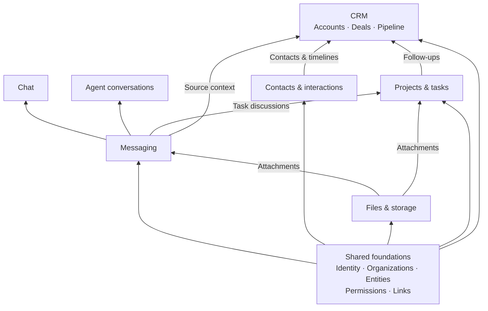

# Database package

## Layout

- Put shared primitives in `src/core/<domain>/`: authentication, organizations, actors, entities, permissions, contacts, and links.
- Put feature code in `src/features/<feature>/`, such as email, calendar, messaging, tasks, CRM, and files.
- Each domain owns its table definitions, repositories, input contracts, and colocated tests. Split them into focused files as the domain grows.
- Core must not import feature implementations. Features may depend on core and on explicit references to other features.
- `src/schema/index.ts` is the schema export registry for Drizzle and applications. Keep repository composition outside individual domains.
- Keep shared test fixtures in `src/testing/`. Do not create a separate tree of test files.

## Shared primitives and feature composition

Arrows mean **“used by”**, not table ownership.

## Persistence and access

- Entity-backed tables use `entity_id`; organization-owned records require `organization_id`.
- Enforce organization and entity-type alignment with composite foreign keys.
- Every entity has an access container in `entities.access_entity_id`: a root is its own container, and a child uses its parent's. Set grants on containers only. Create children with `createChildEntity`. Moving a child must update its container and structural references together; do not expose raw `access_entity_id` edits.
- Repositories take `RepositoryContext`, whitelist writable fields, check actor access, and participate in caller transactions.
- Design writes without explicit locks: no `FOR UPDATE`/`FOR SHARE` or advisory locks. Use guarded writes, compare-and-set on a version, and unique constraints; `SKIP LOCKED` is allowed only to claim queued work.
- Derive actor scope from authenticated server context, not request-supplied identity fields.
- Organization owners and admins get owner access to their organization's shared record types through `readableCondition` and `entityAccessLevel`. Read the role on each query; do not store admin grants. People and personal mailbox or calendar records are excluded. In messaging, admins manage conversations but do not read private messages.
- Raw database access and actor provisioning are trusted server-only APIs. Do not expose them as agent tools.
- Keep integration tables feature-specific. Store connection and sync state together per mailbox or calendar; do not add generic integration or separate sync-state tables without a concrete need.
- Store credential references, not secrets, in feature integration records. Restrict management reads and writes to resource owners.
- Keep provider network calls outside database transactions. Commit imported records and their sync cursor in one repository transaction, using the current sync lease.
- Cross-organization channels and messaging references require a dedicated sharing boundary that checks conversation and target-entity access. Never weaken organization-scoped grants, links, or foreign keys.

## Relationships and context

Load the `database-table-design` skill before you add or change a table, relationship, entity type, or relation type. It has the decision steps and table templates. These rules always apply:

- Every relationship uses exactly one of three mechanisms. Take the first one that fits:
  1. **Structure:** a domain foreign key or join table, when the relationship defines where a record belongs, who is responsible for it, or has its own fields.
  2. **Record context:** `entity_links`, when two entities are related but neither one belongs to the other.
  3. **Message context:** `message_entity_references`, when one end is a message. Messages are not entities.
- Do not add a table for provenance, retries, history, or derived references. Use the `source` message reference or a `related_to` link, `core/requests/once.ts`, the domain's activity table, and the content itself.
- Do not copy a structural relationship into `entity_links`.
- Writing a link needs edit access on the record being changed and view access on the other record. Linking does not grant access or send notifications. Readers see a link only when they can read both ends.
- An entity-type enum value is not an implemented domain. Do not create placeholder entities for unsupported feature types.

## Agent work

- Create every wake through `admit()` in `features/agent-work/wakes/admission.ts`, and put every wake rule in the pure `decideAdmission`. `routeWake` stays the entry point inside the transaction that inserts the message. Wakes hold references, not message bodies; the home desktop reads bodies through the visibility-checked sources query.
- Callers: `decideAdmission` admits, holds or rate-limits a caller's message, and `admit()` records each call in `agent_invocations`. Decide calls with compare-and-set, check the call again at decision time, and create the wake in the decision's transaction. The source check (`loadSources` with invocation IDs) checks queued calls again and drops revoked ones.
- Write `agent_audit_events` rows for caller policy and allowlist changes, call decisions, and MCP calls in caller turns. Store IDs and result codes, never message bodies. Only the agent's owner reads them.
- Answer requests with compare-and-set: the first answer wins.
- Execute a proposal exactly once. Bind it to its action hash and the target state recorded when it was proposed, and check both in the transaction that runs the action.
- Bind agent provenance with composite foreign keys: the actor must belong to the user agent and organization.
- Redact request and status views once the owner loses access to their conversation. Return `origin_turn_id` only to the agent's owner.

## Tests and migrations

- Test repositories and constraints against real PostgreSQL. `TEST_DATABASE_URL` must name a dedicated database ending in `_test`.
- Run `bun run test` from the repository root to use the package's Bun configuration and preload.
- The preload migrates once and shares one pool. Fixtures may reset and insert data, but must not recreate schemas, tables, or indexes.
- Run database tests serially. Concurrency tests may use multiple connections; parallel test files require separate databases.
- Cover invalid references, organization isolation, permission levels, safe links, and transaction rollback for each new domain.
- Generate incremental migrations. Do not rewrite applied migrations.
- Use Drizzle's PostgreSQL migrator. Do not write a custom migration runner, migration-history table, or migration execution logic.
- Commit PostgreSQL enum additions before later SQL uses them. Plan enum changes around Drizzle's migration transaction boundaries.
- Do not add deployment workflows unless requested.
